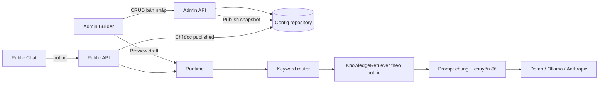

# Chatbot Platform — skeleton admin và runtime

Nền tảng tạo chatbot từ frontend, dựa trên cấu trúc React/Vite + FastAPI của TVTS.
Đặt riêng khỏi `n2nai_chatbot_tvts`: không thay đổi bot tuyển sinh hoặc dữ liệu gốc.

## Chạy local

Backend (Python 3.10+):

```bash
cd chatbot-platform/backend
python3 -m venv .venv
source .venv/bin/activate
pip install -r requirements.txt
export ADMIN_TOKEN='thay-bang-token-dai-ngau-nhien'
uvicorn app.main:app --host 127.0.0.1 --port 8010 --reload
```

Frontend (Node 18+):

```bash
cd chatbot-platform/frontend
npm install
npm run dev
```

Mở http://localhost:5174, nhập cùng ADMIN_TOKEN. API docs: http://127.0.0.1:8010/docs.
Các biến trong backend/.env.example phải export vào shell (chưa tự load .env).

## Luồng chạy được

1. Tạo bot → ID riêng và draft revision 1 trong SQLite.
2. Sửa tên, provider/model, system prompt, fallback, chuyên đề/từ khóa, màu và lời chào.
3. Lưu nháp → revision tăng; preview dùng bản nháp đã lưu.
4. Publish → snapshot độc lập. Sửa draft sau đó không tác động public.
5. Mở `/chat/{bot_id}` để sử dụng bản đã publish; tạo bot khác để kiểm tra độc lập.
6. Muốn xử lý xung đột revision: bấm Tải lại rồi cập nhật lại thay đổi.

Demo hoạt động không cần API key và ghi rõ không gọi mô hình; không thực thi prompt.
Ollama và Anthropic có adapter HTTP thật nhưng phải cấu hình provider ở server và model ID hợp lệ.
Không có danh mục model lấy tự động. Không có API key trong cấu hình gửi tới frontend.
OLLAMA_BASE_URL do server quản lý; không nhận URL tùy ý từ admin.
Runtime trả JSON một lần, chưa stream SSE. History giữ trong bộ nhớ trang và gửi tối đa 10 lượt; chưa lưu hội thoại phía server.

## Cấu trúc

```text
frontend/src/
  main.jsx          Khởi tạo React + Redux Provider
  App.jsx           Chọn trang Login / Studio / PublicChat
  store/slices/     Session, bots, chat, diagnostics + async thunks
  pages/            Các trang ứng dụng
  components/       Layout, chat và các bước cấu hình
  services/api.js   Điểm gọi HTTP thống nhất
  style.css         Giao diện responsive
backend/app/
  main.py           Khởi tạo app, ghép router/service và ánh xạ lỗi HTTP
  modules/          Router admin.py, public.py, health.py
  core/             security.py, dependencies.py, errors.py
  schemas.py        Hợp đồng cấu hình và kiểm tra dữ liệu
  repositories/
    bot_repository.py   SQLite, revision, draft/published snapshot
  services/
    bot_service.py      Vòng đời bot, tách draft/public, lọc cấu hình công khai
    chat_service.py     Điều phối route → retrieval → prompt → provider
    routing_service.py  Chọn chuyên đề theo mode hoặc từ khóa
    knowledge_service.py  Chunk + lexical retrieval theo bot/chuyên đề
    prompt_service.py   Ghép prompt chung và hướng dẫn chuyên đề
    provider_service.py Gọi Ollama/Anthropic
backend/tests/
  test_platform.py  Kiểm tra bảo vệ admin, publish, revision, bot isolation
```

## Kiến trúc đích



## API

| Method | Path | Mục đích |
|---|---|---|
| GET | /api/admin/bots | Danh sách cấu hình, cần Bearer token |
| POST | /api/admin/bots | Tạo bot |
| PUT | /api/admin/bots/{id}/draft | Lưu draft với expected_revision |
| POST | /api/admin/bots/{id}/publish | Publish revision đang xem |
| POST | /api/admin/bots/{id}/preview | Chat với draft đã lưu |
| GET | /api/bots/{id} | Chỉ metadata/theme/routes công khai |
| POST | /api/bots/{id}/chat | Chat với published config |

Public config không trả system prompt, route instruction hoặc cấu hình provider.
Routing: mode chỉ định phải thuộc bot; auto dùng chuyên đề đầu tiên có từ khóa khớp.
Mỗi request tải cấu hình từ repository, không có trạng thái model chung bị đổi giữa các bot.

## Phần cần phát triển tiếp

- Đã tách main.jsx thành pages/components và Redux slices; tiếp tục browser E2E khi mở rộng.
- Đăng nhập SSO/JWT, RBAC theo workspace/bot; token chung hiện chỉ bảo vệ admin local.
- Rate limit, quota/token budget, audit log trước khi mở runtime ra Internet.
- Knowledge: upload, kiểm tra định dạng, ingestion job, metadata, chỉ mục theo bot và quyền.
- KnowledgeRetriever hiện tìm lexical trên tài liệu snapshot của bot, có ghép context và citations metadata.
  Cần bổ sung embedding/hybrid retrieval và đánh giá chất lượng; hiện chưa tương đương RAG TVTS.
- SSE, hủy request, persist hội thoại theo người dùng/bot, kiểm tra quyền xem lịch sử.
- Version history/rollback, archive/delete bot, allowlist provider/model theo workspace.
- Bí mật từng workspace qua secret store. Không thêm API key vào BotConfig.
- Bộ đánh giá routing/retrieval/grounding cho từng bot trước publish production.
- Rich Markdown, thư viện template, logo/upload và kiểm tra khả năng đọc của màu giao diện.

## Chuyển từ TVTS

| TVTS hiện tại | Skeleton mới |
|---|---|
| chat_modes.py cố định | BotConfig.routes theo bot |
| _get_system_prompt nhiều nhánh module | BotConfig.system_prompt + route.instruction |
| intent_classifier.py nghiệp vụ tuyển sinh | router chung; mở rộng qua strategy |
| featureIdentity.js cố định | public config.theme/name/description |
| RAG module tuyển sinh | KnowledgeRetriever nhận bot_id và phạm vi quyền |
| Điều kiện module trong ChatInterface | Một Chat component dùng config |
| Khởi tạo model theo module | Provider adapter lấy config mỗi request |

Có mẫu TVTS trích một phần rule từ chatbot_config, chưa tự import tài liệu. Xem [phạm vi tích hợp và hướng dẫn](docs/TVTS_INTEGRATION.md).

## Kiểm tra

```bash
cd chatbot-platform/backend
python -m unittest discover -s tests -v
cd ../frontend
npm run build
```

SQLite chỉ giữ draft mới nhất và snapshot published mới nhất; revision không phải lịch sử đầy đủ.
Skeleton local chưa phải một nền tảng multi-tenant production hoặc hệ thống đảm bảo chống prompt injection tuyệt đối.

## Rà soát module

Xem [trạng thái và thứ tự triển khai module](docs/MODULE_STATUS.md). Studio có nút ☰ đóng/mở sidebar, hỗ trợ Escape; mobile mặc định thu gọn.

## Cấu hình và rule TVTS

Admin lấy defaults/templates/providers từ `/api/admin/configuration`. Tab Luật trả lời quản lý prompt rules, phản hồi trực tiếp và defer guard. Tab Tri thức thêm Markdown/text UTF-8 theo bot/chuyên đề; lưu nháp và publish cùng snapshot cấu hình. Xem [TVTS_INTEGRATION.md](docs/TVTS_INTEGRATION.md) để biết phần đã dùng lại và phần cần port tiếp.

## Cấu hình dành cho client

Studio có [8 bước cấu hình](docs/CLIENT_CONFIGURATION.md), prompt chi tiết/câu mẫu, ưu tiên điều hướng, tính năng hiển thị và liên kết có điều kiện. Bước kiểm thử cho xem nguồn và prompt của bản nháp đã lưu qua API admin `/api/admin/bots/{id}/inspect`, không gọi model.

## Pipeline và admin nâng cao

Xem [ADVANCED_ADMIN.md](docs/ADVANCED_ADMIN.md): parser Office/PDF, BM25/semantic/hybrid, thư viện 15 khối rule TVTS, hậu xử lý, model theo chuyên đề và registry handler. Đây là trạng thái mới nhất; các giới hạn MD/TXT và lexical-only mô tả ở các giai đoạn trước đã được mở rộng.

## Index bền vững

Chunks và vectors được lưu trong SQLite theo bot + fingerprint snapshot. Lưu nháp tự xếp tác vụ xây index; admin xem trạng thái draft/published và xây lại ở bước Tài liệu/Kiểm thử. Xem [PERSISTENT_INDEX.md](docs/PERSISTENT_INDEX.md) về cách ly phiên bản, xử lý lỗi và giới hạn job nền.

## Frontend Redux

Frontend dùng Redux Toolkit (`createSlice`, `createAsyncThunk`) và React Redux. Xem [FRONTEND_REDUX.md](docs/FRONTEND_REDUX.md) về cấu trúc, luồng dữ liệu và kiểm thử. Chạy `npm install` nếu dùng checkout khác, rồi `npm test` và `npm run build`.
